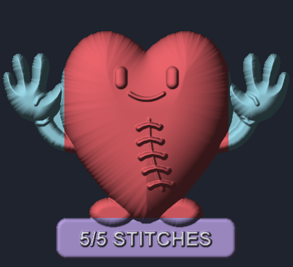
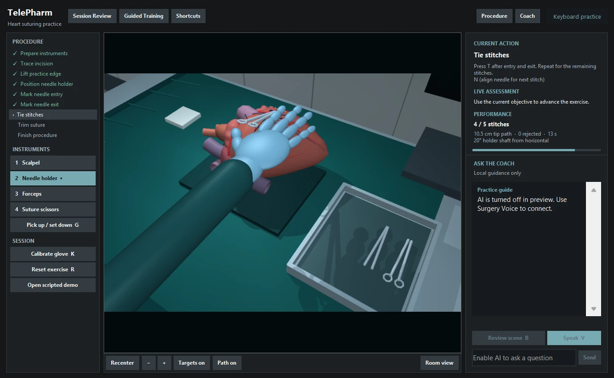
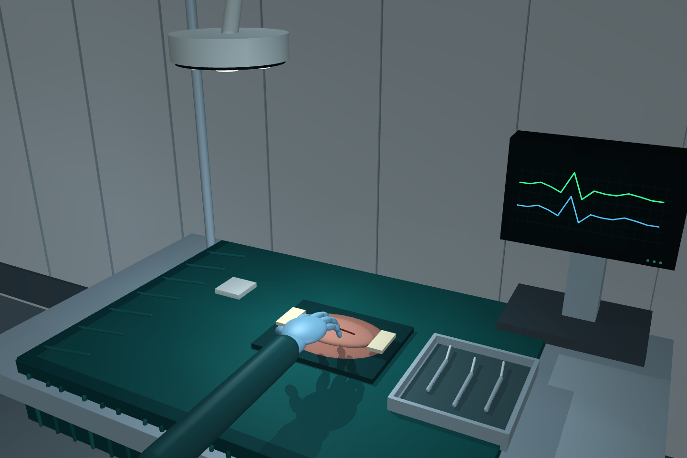
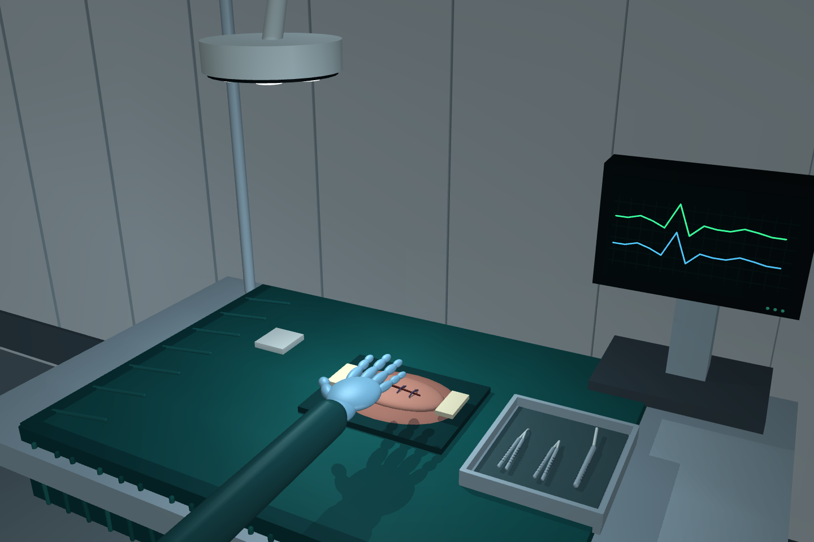
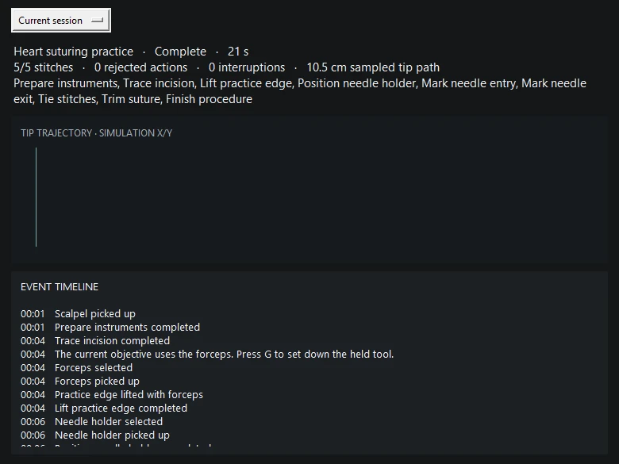
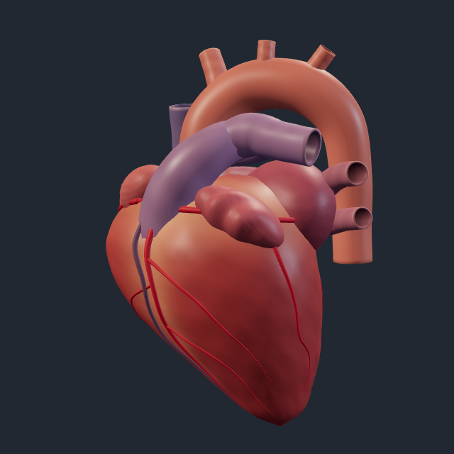
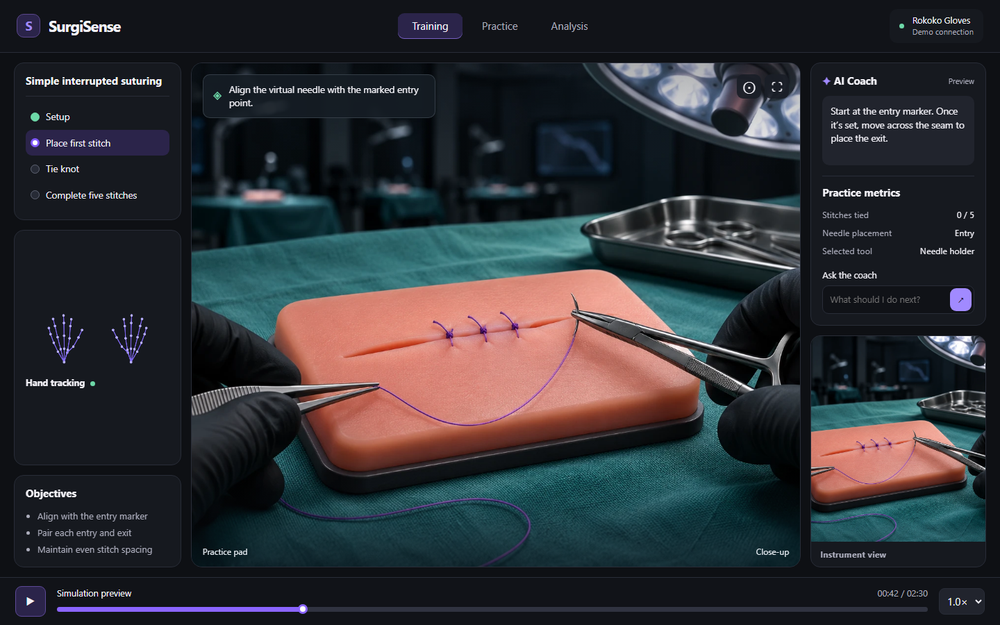
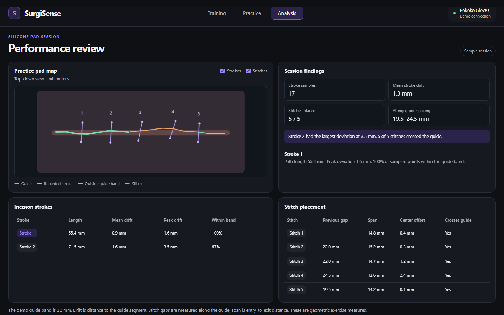
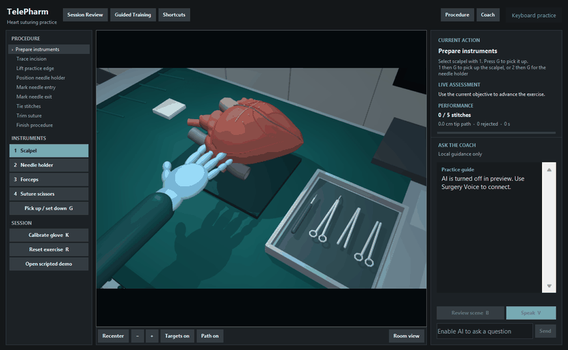
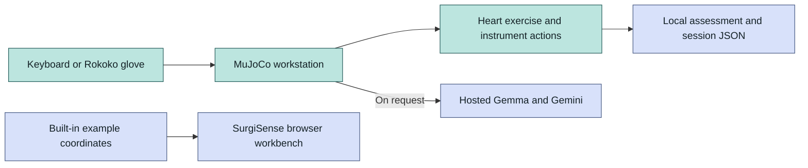

<div align="center">



# TelePharm

### Every stitch leaves a trace.

Practice on a virtual heart, then see where your instruments went and how the attempt unfolded.

**[Take a look](#take-a-look)** · **[Watch a complete run](#first-practice-run)** · **[Run locally](#quick-start)** · **[Explore SurgiSense](#browser-workbench)**


</div>

---

## Take a look

### At the operating table

Follow the guide through an incision, five stitches, and a final trim. The procedure checklist tracks each stage while the live panel shows the tool, next action, and tip measurements.

[](docs/readme/telepharm-workstation.webp)

| The operating room | The practice-pad demo |
| :---: | :---: |
| [](operating_room_preview.png) | [](surgery_stitches_preview.png) |
| The scene behind the desktop workstation. | The scripted instrument and stitching sequence. |

### After the last stitch

**Session Review** puts the attempt’s timeline, virtual tip trajectory, and stitch count together. This keyboard run finished with all five stitches tied and zero rejected actions.

[](docs/readme/telepharm-session-review.webp)

### A closer look in SurgiSense

In the browser workbench, click a stroke or stitch on the sample pad to inspect it. The workbench also lets you toggle layers, replay the sample, and export measurements.

[](docs/readme/surgisense-workbench.webp)

<details>
<summary><strong>More from the project gallery</strong></summary>

| Heart mesh | Stitch-heart mascot |
| :---: | :---: |
| [](human-heart-preview.png) | [](stitch-heart-mascot.png) |
| [Heart model file](human-heart.glb) | [Mascot model file](stitch-heart-mascot.stl) |

**SurgiSense workstation prototype**

[](surgisense-design/dashboard-preview.png)

**SurgiSense analysis prototype**

[](surgisense-design/analysis-preview.png)

</details>

## Quick start

| I want to… | Open | What I need |
| --- | --- | --- |
| Explore a sample session | [SurgiSense browser workbench](#browser-workbench) | A browser and the local workspace files |
| Practice on the virtual heart | [Guided Training](#launch-the-desktop-workstation) | Windows, Python 3.11 with Tk, and working OpenGL graphics |
| Watch the practice-pad demo | [Scripted demo](#launch-modes) | The same desktop setup |
| Use a glove or hosted coach | [Live glove and AI coaching](#live-glove-and-ai-coaching) | A licensed Rokoko Device SDK for USB tracking, or an AI Studio key for hosted coaching |

### Launch the desktop workstation

Open PowerShell in the folder containing `hand_lab.py` and `human-heart.glb`. With Python 3.11 on your `PATH`, run:

```powershell
python -m venv .venv
.\.venv\Scripts\python.exe -m pip install mujoco numpy Pillow lz4
.\.venv\Scripts\python.exe -B hand_lab.py --preview --guided
```

The window should show **Keyboard practice**, four instruments, and the procedure checklist. You can complete and review an attempt offline after installing the dependencies. Keep `human-heart.glb` and `surgery_lab.xml` alongside `hand_lab.py`.

### Launch modes

<details open>
<summary><strong>Windows launchers and their options</strong></summary>

The `.cmd` files use `python` from `PATH`. To use them with the virtual environment above, run the following in the current PowerShell window:

```powershell
$env:Path = "$(Resolve-Path .\.venv\Scripts);$env:Path"
```

| Launcher | Opens |
| --- | --- |
| [`Surgery Guided Preview.cmd`](Surgery%20Guided%20Preview.cmd) | Guided heart workstation with keyboard input |
| [`Surgery Preview.cmd`](Surgery%20Preview.cmd) | Manual practice-pad viewer. Press <kbd>T</kbd> for its automated sequence. |
| [`Surgery Demo.cmd`](Surgery%20Demo.cmd) | Practice-pad viewer with the scripted sequence already running |
| [`Surgery Live.cmd`](Surgery%20Live.cmd) with `--guided` | Heart workstation with USB glove input and local feedback |
| [`Surgery Gemma.cmd`](Surgery%20Gemma.cmd) | Keyboard practice-pad viewer with hosted still-frame review. Add `--guided` for the heart. |
| [`Surgery Voice.cmd`](Surgery%20Voice.cmd) | Guided heart workstation with glove input and both hosted coaches. Add `--preview` to use the keyboard. |

Run `.\.venv\Scripts\python.exe hand_lab.py --help` for the available flags. The pad viewer has its own controls. In that viewer <kbd>Q</kbd> lowers, <kbd>E</kbd> raises, and <kbd>H</kbd> assists placing a stitch. The heart workstation uses <kbd>Q</kbd> to raise and <kbd>E</kbd> to lower.

</details>

## First practice run

<details>
<summary><strong>Watch a complete keyboard attempt</strong></summary>



</details>

1. **Trace the virtual incision.** Press <kbd>1</kbd>, <kbd>G</kbd>, <kbd>N</kbd>, then <kbd>E</kbd> twice. Hold <kbd>↑</kbd> to follow the visible guide to its end. Use the procedure checklist to confirm the trace is complete.
2. **Lift the practice edge.** Set down the scalpel with <kbd>G</kbd>. Press <kbd>3</kbd>, <kbd>G</kbd>, <kbd>N</kbd>, then <kbd>F</kbd> to grip. Tap <kbd>Q</kbd> to lift, <kbd>F</kbd> to release, and <kbd>G</kbd> to set down the forceps.
3. **Tie five stitches.** Press <kbd>2</kbd> and <kbd>G</kbd>. For each stitch, use <kbd>N</kbd> → <kbd>E</kbd> twice → <kbd>F</kbd> on the first edge, repeat on the opposite edge, then press <kbd>T</kbd>.
4. **Finish the exercise.** Set down the holder with <kbd>G</kbd>. Press <kbd>4</kbd>, <kbd>G</kbd>, <kbd>N</kbd>, <kbd>X</kbd> to trim the last stitch, then <kbd>G</kbd> to set down the scissors. Open **Session Review** to see the result.

<details>
<summary><strong>Keyboard shortcuts and viewport controls</strong></summary>

| Control | Action in the heart workstation |
| --- | --- |
| <kbd>1</kbd> / <kbd>2</kbd> / <kbd>3</kbd> / <kbd>4</kbd> | Select scalpel / needle holder / forceps / suture scissors |
| <kbd>G</kbd> | Pick up the selected instrument or set down the held one |
| <kbd>↑</kbd> <kbd>↓</kbd> <kbd>←</kbd> <kbd>→</kbd> or <kbd>W</kbd> <kbd>A</kbd> <kbd>S</kbd> <kbd>D</kbd> | Translate along the table |
| <kbd>Q</kbd> / <kbd>E</kbd> | Raise / lower |
| <kbd>N</kbd> | Assist with tool alignment for the current action |
| <kbd>F</kbd> / <kbd>T</kbd> / <kbd>X</kbd> | Place a needle entry or exit point, or toggle the forceps grip / tie / trim |
| <kbd>C</kbd> / <kbd>R</kbd> / <kbd>K</kbd> | Park the tool and recenter the hand / save and reset the attempt / calibrate the live glove |
| <kbd>B</kbd> / <kbd>V</kbd> | Request a Gemma frame review / toggle Gemini microphone capture. Both require the corresponding coach. |

The viewport toolbar switches between room and close-up views, zooms and recenters the camera, and toggles **Targets** and the recent tip **Path**. Click **Guided Training** to switch to **Free Practice**, which hides the targets and stage hints. Click the viewport to return keyboard focus after using the coach panel.

</details>

## Session review

**Session Review** opens the current attempt or a recent saved one. The review shows duration, completed stages, stitches tied, rejected actions, tracking interruptions, an event timeline, and a top-down plot of the instrument-tip path. Attempts with recorded events are written as JSON when you press <kbd>R</kbd> or close the workstation normally. On Windows, find them in `%LOCALAPPDATA%\TelePharm\sessions`.

<details>
<summary><strong>What the simulator measures</strong></summary>

| Measure | Meaning |
| --- | --- |
| Sampled tip path | Distance accumulated between consecutive tool-tip samples at up to 10 Hz. The app skips long gaps, tool changes, tracking-state changes, and assisted jumps. |
| Virtual tip variation | RMS distance of recent tip samples from the midpoints of their neighbors, in millimeters. |
| Holder shaft angle | Needle-holder elevation relative to the horizontal table. |
| Distance to guide | Distance from the virtual tip to the active assisted target, when available. |
| Rejected actions | Inputs such as a puncture attempted before lowering to the target, with the reason recorded in the timeline. |

The heart surface and interactions are geometric simulations, with scripted tool actions and rendered marks. The prototype lacks deformable tissue, measured contact forces, physical thread tension, and validated clinical proficiency scoring. Its measurements describe the virtual exercise.

</details>

## Browser workbench

Open [`surgisense-workbench/index.html`](surgisense-workbench/index.html) **from your local files**. On Windows, run the following from the workspace root, or double-click the file in Explorer:

```powershell
Start-Process .\surgisense-workbench\index.html
```

Select **Explore session analysis**, then choose a stroke or stitch on the pad map to see its measurements. Toggle **Strokes**, **Stitches**, and **Band**, or use **Export measurements** for a CSV. Under **Practice**, press **Play** or drag the slider to move through the 48-second sample. Under **Training**, select a stage to see its cue.

The workbench runs on built-in sample coordinates. The desktop workstation saves its own attempts as local JSON for **Session Review**.

## Live glove and AI coaching

<details>
<summary><strong>Connect a Rokoko Smartglove over USB</strong></summary>

1. Install and activate the [Rokoko Device SDK](https://sdk.rokoko.com/) and connect a USB-streaming-capable Smartglove. Close Rokoko Studio if it is using the glove.
2. Apply the `PATH` step under [Launch modes](#launch-modes), then run the launcher from the workspace root. Add `--hand left` for a left glove. The default is right.

   ```powershell
   & '.\Surgery Live.cmd' --guided
   ```

3. Wait for the calibration prompt. Hold your hand flat and press <kbd>K</kbd> with the viewport focused. Use the keyboard to translate the hand while the glove controls wrist orientation and finger curl.

The launcher reuses a service on `127.0.0.1:12276` or starts `%LOCALAPPDATA%\Rokoko Device SDK\bin\rokoko-sdk.exe` with `--auto-stream-usb`. If your SDK is already running on a custom port, call `hand_lab.py --sdk --guided --sdk-port PORT` directly. For local Rokoko Studio UDP input instead, run `hand_lab.py --guided` with Studio streaming to `127.0.0.1:14043`, or set `--port PORT` to match.

</details>

<details>
<summary><strong>Enable Gemma frame review and Gemini voice or text</strong></summary>

Install `sounddevice` for voice and get a key from [Google AI Studio](https://ai.google.dev/gemini-api/docs/api-key). To try both coaches with the keyboard:

```powershell
.\.venv\Scripts\python.exe -m pip install sounddevice
& '.\Surgery Voice.cmd' --preview
```

Use the `PATH` step under [Launch modes](#launch-modes) first. The Windows launcher can read `SURGERY_GEMMA_API_KEY` from a local `.env` or the environment. If it prompts you for a key, it saves the entry encrypted for your Windows account. Use `--replace-key` to replace the saved key. Keep keys out of commits.

| Action | Data sent to the hosted coach |
| --- | --- |
| <kbd>B</kbd> or **Review scene** | A rendered simulation frame plus current exercise context goes to Gemma. |
| <kbd>V</kbd> or **Start voice** | A microphone clip after a pause, plus exercise context, goes to Gemini. The app pauses capture during speech playback. |
| Type in **Ask the Coach** | The question and current exercise context go to Gemini. |
| **Ask Gemini for a review** | A summary of the selected attempt, including counts, completed stages, and up to 20 recent events, goes to Gemini. The reply opens in the coach panel. |

Frame-only coaching works without `sounddevice`. Use `& '.\Surgery Gemma.cmd' --guided` to enable it in the keyboard workstation. The local checklist, measurements, and session review are available with coaching disabled.

</details>

## Project map



| Files | Role |
| --- | --- |
| [`hand_lab.py`](hand_lab.py), [`surgery_interface.py`](surgery_interface.py) | Desktop entry point and Tk workstation UI |
| [`guided_surgery.py`](guided_surgery.py), [`heart_surface.py`](heart_surface.py), [`surgery_lab.xml`](surgery_lab.xml) | Instrument actions, heart surface, and operating-room scene |
| [`training_session.py`](training_session.py) | Local assessment, trajectory sampling, and JSON reports |
| [`rokoko_rgmp.py`](rokoko_rgmp.py), [`Start-Surgery.ps1`](Start-Surgery.ps1) | Glove input and Windows live launcher |
| [`gemma_coach.py`](gemma_coach.py), [`gemini_voice.py`](gemini_voice.py) | Hosted visual, voice, and text coaching |
| [`suturing.py`](suturing.py), [`surgisense-workbench/`](surgisense-workbench/) | Scripted practice pad and standalone browser workbench |

<details>
<summary><strong>Other prototypes, assets, and licensing</strong></summary>

- [`surgical-training-simulator/`](surgical-training-simulator/) and [`surgical-training-simulator-dashboard/`](surgical-training-simulator-dashboard/) have their own READMEs and dependencies. The dashboard variant documents an optional database-backed session history.
- [`surgisense-design/`](surgisense-design/) and [`surgisense-website/`](surgisense-website/) are alternate browser prototypes.
- [`telepharm.py`](telepharm.py), [`hotcell_scene.xml`](hotcell_scene.xml), and [`arduino_knob.ino`](arduino_knob.ino) belong to a separate hot-cell simulation. Run `python telepharm.py --mock` from the workspace root for keyboard input. The optional serial knob path uses `pyserial`.
- This workspace has no root license file. The bundled Inter font has its own [Open Font License](surgisense-workbench/inter-OFL.txt).

</details>

## Troubleshooting

<details>
<summary><strong>Viewer startup, tracking, microphone, or missing sessions</strong></summary>

| Symptom | Check |
| --- | --- |
| `ModuleNotFoundError` | Install packages with the same Python executable that runs `hand_lab.py`. For `.cmd` launchers, check `Get-Command python`. |
| The viewer fails to create a render context | Use a Windows desktop session with working OpenGL graphics. Run `python hand_lab.py --snapshot telepharm-preview.png` with the configured interpreter to test the practice-pad renderer. |
| The glove stays on **Waiting** | Check the USB connection, the SDK license and process, and the `--hand` setting. If the launcher started the driver, inspect `surgery-sdk.err.log` in `%TEMP%`. |
| The avatar moves unexpectedly | Hold the hand flat and recalibrate with <kbd>K</kbd> while the stream is active. Press <kbd>C</kbd> if you also need to park the tool and recenter the hand. |
| <kbd>V</kbd> cannot open the microphone | Check `sounddevice`, the Windows default recording device, and microphone permissions. With voice mode enabled, you can still type in the coach panel. |
| The coach reports an API error | Check that the key has access to the model configured in the coach module and that the machine can reach the Gemini API. |
| A run is missing from history | Perform a recorded action, then press <kbd>R</kbd> or close the guided workstation normally. The scripted pad and browser sample use separate entry points. |
| The browser link shows HTML source | Open the local `index.html` file in a browser so it can load its neighboring scripts and styles. |

</details>

[Back to top](#telepharm)
