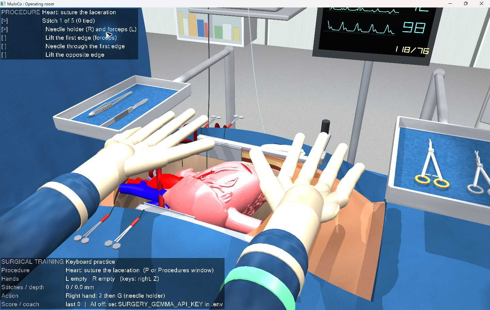
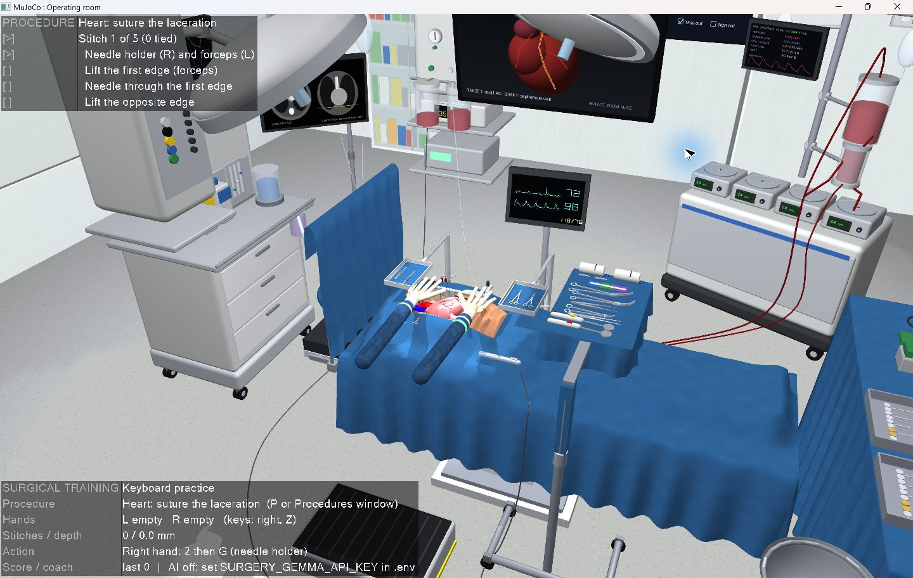
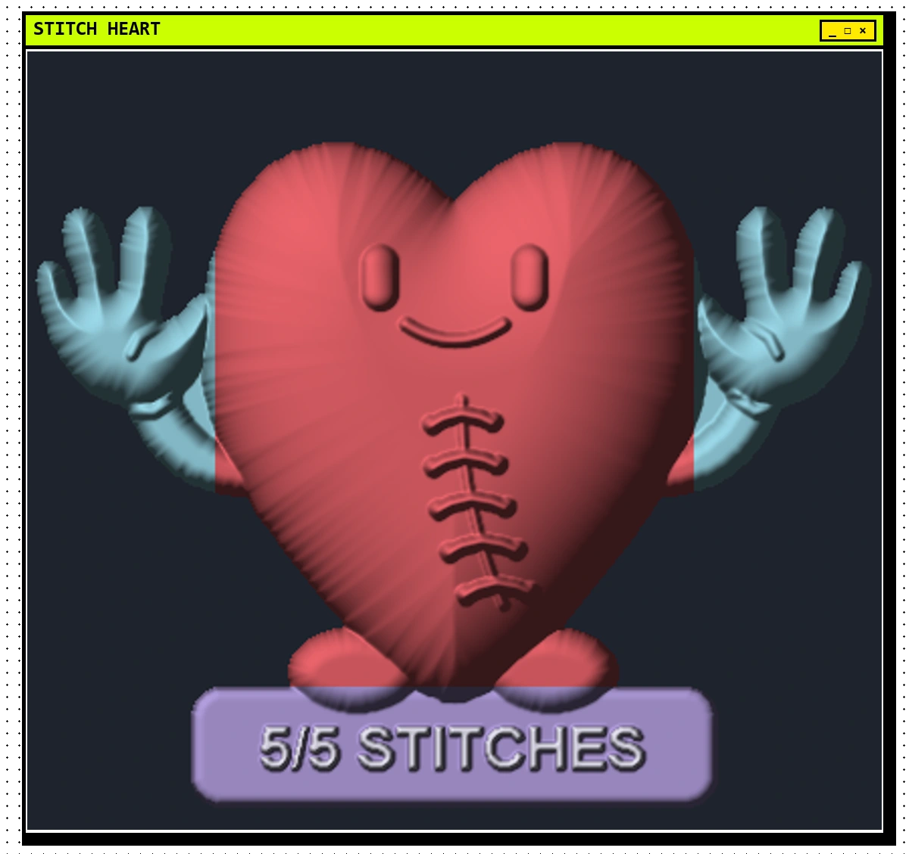
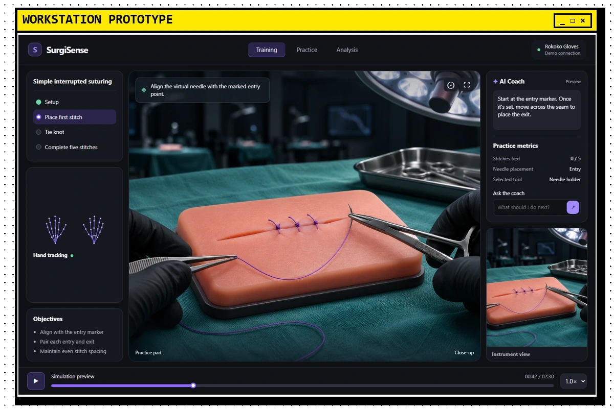
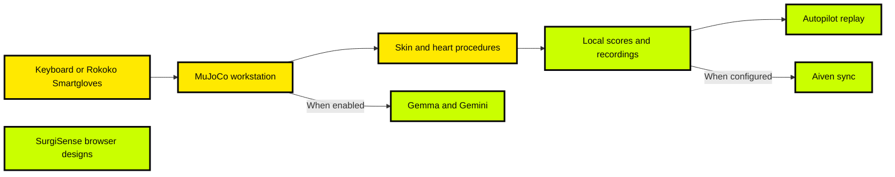

<div align="center">


# Anatomation

**The Anatomation virtual surgical training workstation**

Practice two-handed incisions, suturing, and coronary bypass in a virtual cardiac operating room. Review your scores and replay your best recorded attempt.

**[Take a look](#take-a-look)** · **[Try a keyboard run](#first-practice-run)** · **[Run locally](#quick-start)** · **[Explore Anatomation](#browser-workbench)**


</div>

---

## Take a look

### At the operating table

Control two hands with the keyboard or Rokoko Smartgloves. The procedure checklist tracks each step, and the status overlay shows the instrument in each hand, stitch count, and the next action.

[](docs/readme/current-heart-suture.jpg)

| The operating room | Skin suturing |
| :---: | :---: |
| [](docs/readme/current-operating-room.jpg) | [](docs/readme/current-skin-suture.jpg) |
| The cardiac simulator’s table, equipment, and animated displays. | A laceration on the curved chest surface, with the instruments ready for the first stitch. |

### Follow the procedure

The **Anatomation | Procedures** window lists the available exercises and tracks the current one. In this keyboard run, the needle holder and forceps are in place and the checklist has advanced to the first stitch.

[](docs/readme/current-procedures.jpg)


<details>
<summary><strong>More from the project gallery</strong></summary>

| Heart model | Stitch-heart mascot |
| :---: | :---: |
| [](docs/readme/current-heart-suture.jpg) | [](stitch-heart-mascot.png) |
| [NIH 3D model files](assets/heart-nih3d/) | [Mascot artwork](stitch-heart-mascot.png) |

**Anatomation workstation prototype**

[](surgisense-design/dashboard-preview.png)

</details>

## Quick start

| I want to… | Open | What I need |
| --- | --- | --- |
| Practice suturing on skin | [Desktop workstation](#launch-the-desktop-workstation) | Python 3.11 with Tk and working OpenGL |
| Try a heart procedure | [Launch modes](#launch-modes) | The same desktop setup |
| Explore the Anatomation designs | [Browser workbench](#browser-workbench) | The static design previews in this repository |
| Use gloves or a hosted coach | [Live glove and AI coaching](#live-glove-and-ai-coaching) | Rokoko Device SDK and hand solver for live tracking, or hosted coaching credentials |

### Launch the desktop workstation

Open PowerShell at the repository root and run:

```powershell
py -3.11 -m venv .venv
.\.venv\Scripts\python.exe -m pip install -r requirements.txt
.\.venv\Scripts\python.exe surgical_suturing_guided.py --preview
```

The **MuJoCo: Operating room** and **Anatomation | Procedures** windows open with **Skin: suture the laceration** selected. Preview mode uses the keyboard for both hands. For macOS setup, see the [simulator guide](SIMULATOR.md#run-on-macos).

### Launch modes

<details open>
<summary><strong>Choose a procedure</strong></summary>

Select an exercise in **Anatomation | Procedures**, or press <kbd>P</kbd> in the viewer to cycle through the exercises. If you close the picker, click **Procedures** in the viewer’s **Equality** panel to reopen it.

| Exercise | `--procedure` values |
| --- | --- |
| Guided incision | `skin-incision`, `heart-incision` |
| Guided suturing | `skin-suture` (default), `heart-suture` |
| Guided coronary artery bypass | `heart-bypass` |
| Prompted free stitching | `skin-stitch`, `heart-stitch` |
| Free practice | `skin-free`, `heart-free` |

To open directly on the heart:

```powershell
.\.venv\Scripts\python.exe surgical_suturing_guided.py --preview --procedure heart-suture
```

</details>

## First practice run

<details>
<summary><strong>Follow the keyboard checklist</strong></summary>

In **Skin: suture the laceration**, the green cuff marks the hand controlled by the movement keys. The status overlay identifies the hand and the next key. Use the **Procedures** window to see the full checklist for the current stitch.

</details>

1. **Equip both hands.** Press <kbd>2</kbd>, then <kbd>G</kbd> to give the right hand the needle holder. The active hand switches to the left. Press <kbd>3</kbd>, then <kbd>G</kbd> to pick up the forceps.
2. **Follow the stitch prompts.** The left forceps lift each edge while the right needle holder passes through it. The left forceps then grasp the needle tip and pull the virtual suture through.
3. **Tie and finish.** Use <kbd>T</kbd> for each of the three knot throws. Follow the checklist through the remaining stitches and use the status overlay to see the score. See the [simulator guide](SIMULATOR.md#two-handed-technique) for the full exercise sequence.

<details>
<summary><strong>Keyboard shortcuts and viewport controls</strong></summary>

| Control | Action in the workstation |
| --- | --- |
| <kbd>1</kbd> / <kbd>2</kbd> / <kbd>3</kbd> / <kbd>4</kbd> | Select scalpel / needle holder / forceps / suture scissors |
| <kbd>G</kbd> | Pick up the selected instrument or set down the held one |
| <kbd>↑</kbd> <kbd>↓</kbd> <kbd>←</kbd> <kbd>→</kbd> | Translate along the table |
| <kbd>Q</kbd> / <kbd>E</kbd> | Raise / lower |
| <kbd>Z</kbd> / <kbd>Y</kbd> | Swap hands / toggle moving both hands together |
| <kbd>N</kbd> | Assist with tool alignment for the current action |
| <kbd>F</kbd> / <kbd>T</kbd> / <kbd>X</kbd> | Grip or pass the needle / throw a knot / trim |
| <kbd>R</kbd> / <kbd>K</kbd> / <kbd>H</kbd> | Save and reset the attempt / toggle the key guide / recalibrate the gloves |
| <kbd>I</kbd> / <kbd>B</kbd> / <kbd>V</kbd> | Open the AI assistant / request a Gemma review / toggle Gemini voice |

Scroll to zoom, left-drag to orbit, right-drag to pan, and press <kbd>0</kbd> to reset the view. Double-click a hand to select it, or double-right-click a spot to zoom around it.

</details>

## Session review

The status overlay shows the most recent score and the best complete score for the current procedure. The simulator writes attempt summaries to `training-data/attempts/` when you finish, press <kbd>R</kbd>, switch exercises, or close the viewer with an attempt in progress. Complete recordings are saved in `training-data/runs/`.

Choose **Autopilot** in the **Equality** panel to replay the best complete recording for the current procedure. Starting replay also exports the instrument trajectory to `training-data/robot/`.

<details>
<summary><strong>What the simulator measures</strong></summary>

| Measure | Meaning |
| --- | --- |
| Task time | Elapsed time for each recorded cut or stitch |
| Instrument travel | Distance traveled by the instrument tip during a task |
| Rejected actions | Inputs the simulator refused, such as a needle pass attempted before the target was reached |
| Needle accuracy | Distance from the needle target during a pass |

The score describes performance within the simulated exercise.

</details>

## Browser workbench

Explore the [Anatomation design previews](surgisense-design/) for the browser workstation and analysis layouts. The desktop simulator writes its own attempt summaries and recordings to `training-data/`.

## Live glove and AI coaching

<details>
<summary><strong>Connect Rokoko Smartgloves over USB</strong></summary>

1. Start the Rokoko Device SDK with `rokoko-sdk --auto-stream-usb`.
2. In a separate terminal, start the hand solver with `rkk-hand-solver --no-driver --emit-openxr`. The simulator reads the solver’s local TCP stream on port `12277`.
3. Launch the simulator without `--preview`. Focus the viewport, press <kbd>H</kbd>, and rest your hands palm-down with your fingers pointing toward the monitor to calibrate.

A hand without a connected glove uses the keyboard. See the [documented macOS setup](SIMULATOR.md#run-on-macos) for the full launch commands.

</details>

<details>
<summary><strong>Enable Gemma frame review and Gemini voice or text</strong></summary>

Install the optional requirements in the project’s virtual environment:

```powershell
.\.venv\Scripts\python.exe -m pip install -r requirements-ai.txt
```

Copy [`.env.example`](.env.example) to `.env`. Set `SURGERY_GEMMA_API_KEY` for Gemini and hosted Gemma, or configure `GEMMA_MODAL_URL` and `GEMMA_MODAL_TOKEN` for Gemma on Modal.

| Action | Data sent to the hosted coach |
| --- | --- |
| <kbd>B</kbd> or **Gemma review** | A rendered simulation frame and exercise context go to Gemma. |
| <kbd>V</kbd> or **AI Voice** | Gemini receives microphone clips and exercise context while voice is active. |
| <kbd>I</kbd> or **AI Assistant**, then type a question | Gemini receives the question and current exercise context. |

For optional PostgreSQL attempt sync and Kafka telemetry, follow the [Aiven setup in the simulator guide](SIMULATOR.md#recording-scoring-autopilot-and-ai-coach). The simulator can score, save, and replay exercises locally.

</details>

## Cardiac operating room (environment)

`surgical_suturing_guided.py` runs in a full cardiac operating room from `environment/`
(`environment_simulator.xml`, included by `or_scene.py`): the draped patient on the OR table,
intact prepped skin (skin procedures) or the opened chest with retractor, pericardium and bypass
lines into the heart (heart procedures), heart-lung machine, anaesthesia machine, surgical lights,
an extra cardiac instrument stand beside the trays, and moving screens (vitals, CT viewer, beating
heart, perfusion, case board). Cuts and stitches on the skin follow the curve of the chest.
`environment/or_controls.py` (numpy + mujoco only) adds these buttons to the viewer's Equality
panel, next to Procedures, Reset hands and the others:

| Control | Action |
| --- | --- |
| **Reset view** | Camera back to the surgeon's view (like <kbd>0</kbd>) |
| **Reset instruments** | Tools back in the trays (the repair stays), heart back in the chest |
| **Lift heart out** / double-click the heart | Lifts the heart out of the chest; Ctrl + right-drag moves it, Ctrl + left-drag turns it; wounds and stitches move with it. The button again puts it back |
| **Load heart (STL)** or `--heart file.stl` | Another heart model (STL or OBJ; x anterior, y left, z superior; mm or m) replaces the NIH heart; the viewer reopens with it |
| Camera | Stays inside the room when zooming out |

`environment/README.txt` explains how it is connected; replace the whole folder to update it.

## Project map



| Files | Role |
| --- | --- |
| [`surgical_suturing_guided.py`](surgical_suturing_guided.py), [`procedure_window.py`](procedure_window.py) | Desktop entry point, glove input, and procedure picker |
| [`procedures.py`](procedures.py), [`bypass.py`](bypass.py) | Exercise definitions and the coronary bypass procedure |
| [`or_scene.py`](or_scene.py), [`environment/`](environment/) | Operating-room scene, instruments, and viewer controls |
| [`motion_log.py`](motion_log.py), [`aiven_store.py`](aiven_store.py) | Scoring, recording, replay, and optional sync |
| [`coach.py`](coach.py), [`gemma_review.py`](gemma_review.py), [`gemini_voice.py`](gemini_voice.py) | Visual, voice, and text coaching |
| [`SIMULATOR.md`](SIMULATOR.md) | Full simulator guide |

<details>
<summary><strong>Other prototypes, assets, and licensing</strong></summary>

- [`surgisense-design/`](surgisense-design/) contains the static workstation and analysis designs.
- [`assets/heart-nih3d/`](assets/heart-nih3d/) contains the NIH 3D heart model, meshes, and materials.
- [`environment/README.txt`](environment/README.txt) documents the cardiac operating-room scene and its integration.

</details>

##  Troubleshooting

<details>
<summary><strong>Viewer startup, tracking, microphone, or missing sessions</strong></summary>

| Symptom | Check |
| --- | --- |
| `ModuleNotFoundError` | Install `requirements.txt` using the same virtual environment that launches `surgical_suturing_guided.py`. |
| The viewer fails to create a render context | Run in a desktop session with working OpenGL graphics. On macOS, launch with `mjpython`. |
| The Procedures window closed | Open **Equality** in the viewer and click **Procedures**, or press <kbd>P</kbd> to cycle through exercises. |
| The glove stays on **Waiting** | Check the USB connection, Device SDK, and hand solver stream on port `12277`. |
| The glove points the wrong way | Press <kbd>H</kbd> in the viewer and rest your hands palm-down with fingers toward the monitor. |
| <kbd>V</kbd> cannot open the microphone | Install `requirements-ai.txt` and check the current default input device and microphone permissions. |
| The coach reports an API error | Check the credentials for the selected backend and network access to its endpoint. |
| Autopilot has no replay | Complete an attempt in the same procedure so a recording is available. |

</details>

[Back to top](#anatomation)
