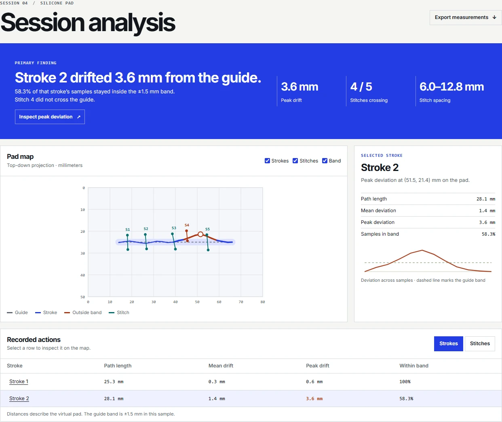
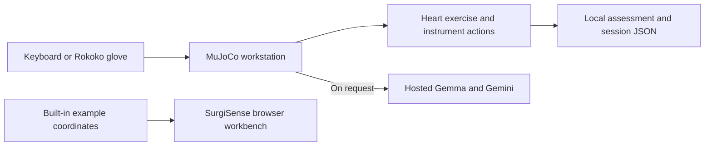

| Measure | Meaning |
| --- | --- |
| Sampled tip path | Distance accumulated between consecutive tool-tip samples at up to 10 Hz. The app skips long gaps, tool changes, tracking-state changes, and assisted jumps. |
| Virtual tip variation | RMS distance of recent tip samples from the midpoints of their neighbors, in millimeters. |
| Holder shaft angle | Needle-holder elevation relative to the horizontal table. |
| Distance to guide | Distance from the virtual tip to the active assisted target, when available. |
| Rejected actions | Inputs such as a puncture attempted before lowering to the target, with the reason recorded in the timeline. |

The heart surface and interactions are geometric simulations, with scripted tool actions and rendered marks. The prototype lacks deformable tissue, measured contact forces, physical thread tension, and validated clinical proficiency scoring. Its measurements describe the virtual exercise.

</details>

## Browser workbench

Open [`surgisense-workbench/index.html`](surgisense-workbench/index.html) **from your local files**. On Windows, run the following from the workspace root, or double-click the file in Explorer:

```powershell
Start-Process .\surgisense-workbench\index.html
```

Select **Explore session analysis**, then choose a stroke or stitch on the pad map to see its measurements. Toggle **Strokes**, **Stitches**, and **Band**, or use **Export measurements** for a CSV. Under **Practice**, press **Play** or drag the slider to move through the 48-second sample. Under **Training**, select a stage to see its cue.

[](docs/readme/surgisense-workbench.webp)

The workbench runs on built-in sample coordinates. The desktop workstation saves its own attempts as local JSON for **Session Review**.

## Live glove and AI coaching

<details>
<summary><strong>Connect a Rokoko Smartglove over USB</strong></summary>

1. Install and activate the [Rokoko Device SDK](https://sdk.rokoko.com/) and connect a USB-streaming-capable Smartglove. Close Rokoko Studio if it is using the glove.
2. Apply the `PATH` step under [Launch modes](#launch-modes), then run the launcher from the workspace root. Add `--hand left` for a left glove. The default is right.

   ```powershell
   & '.\Surgery Live.cmd' --guided
   ```

3. Wait for the calibration prompt. Hold your hand flat and press <kbd>K</kbd> with the viewport focused. Use the keyboard to translate the hand while the glove controls wrist orientation and finger curl.

The launcher reuses a service on `127.0.0.1:12276` or starts `%LOCALAPPDATA%\Rokoko Device SDK\bin\rokoko-sdk.exe` with `--auto-stream-usb`. If your SDK is already running on a custom port, call `hand_lab.py --sdk --guided --sdk-port PORT` directly. For local Rokoko Studio UDP input instead, run `hand_lab.py --guided` with Studio streaming to `127.0.0.1:14043`, or set `--port PORT` to match.

</details>

<details>
<summary><strong>Enable Gemma frame review and Gemini voice or text</strong></summary>

Install `sounddevice` for voice and get a key from [Google AI Studio](https://ai.google.dev/gemini-api/docs/api-key). To try both coaches with the keyboard:

```powershell
.\.venv\Scripts\python.exe -m pip install sounddevice
& '.\Surgery Voice.cmd' --preview
```

Use the `PATH` step under [Launch modes](#launch-modes) first. The Windows launcher can read `SURGERY_GEMMA_API_KEY` from a local `.env` or the environment. If it prompts you for a key, it saves the entry encrypted for your Windows account. Use `--replace-key` to replace the saved key. Keep keys out of commits.

| Action | Data sent to the hosted coach |
| --- | --- |
| <kbd>B</kbd> or **Review scene** | A rendered simulation frame plus current exercise context goes to Gemma. |
| <kbd>V</kbd> or **Start voice** | A microphone clip after a pause, plus exercise context, goes to Gemini. The app pauses capture during speech playback. |
| Type in **Ask the Coach** | The question and current exercise context go to Gemini. |
| **Ask Gemini for a review** | A summary of the selected attempt, including counts, completed stages, and up to 20 recent events, goes to Gemini. The reply opens in the coach panel. |

Frame-only coaching works without `sounddevice`. Use `& '.\Surgery Gemma.cmd' --guided` to enable it in the keyboard workstation. The local checklist, measurements, and session review are available with coaching disabled.

</details>

## Project map



| Files | Role |
| --- | --- |
| [`hand_lab.py`](hand_lab.py), [`surgery_interface.py`](surgery_interface.py) | Desktop entry point and Tk workstation UI |
| [`guided_surgery.py`](guided_surgery.py), [`heart_surface.py`](heart_surface.py), [`surgery_lab.xml`](surgery_lab.xml) | Instrument actions, heart surface, and operating-room scene |
| [`training_session.py`](training_session.py) | Local assessment, trajectory sampling, and JSON reports |
| [`rokoko_rgmp.py`](rokoko_rgmp.py), [`Start-Surgery.ps1`](Start-Surgery.ps1) | Glove input and Windows live launcher |
| [`gemma_coach.py`](gemma_coach.py), [`gemini_voice.py`](gemini_voice.py) | Hosted visual, voice, and text coaching |
| [`suturing.py`](suturing.py), [`surgisense-workbench/`](surgisense-workbench/) | Scripted practice pad and standalone browser workbench |

<details>
<summary><strong>Other prototypes, assets, and licensing</strong></summary>

- [`surgical-training-simulator/`](surgical-training-simulator/) and [`surgical-training-simulator-dashboard/`](surgical-training-simulator-dashboard/) have their own READMEs and dependencies. The dashboard variant documents an optional database-backed session history.
- [`surgisense-design/`](surgisense-design/) and [`surgisense-website/`](surgisense-website/) are alternate browser prototypes.
- [`telepharm.py`](telepharm.py), [`hotcell_scene.xml`](hotcell_scene.xml), and [`arduino_knob.ino`](arduino_knob.ino) belong to a separate hot-cell simulation. Run `python telepharm.py --mock` from the workspace root for keyboard input. The optional serial knob path uses `pyserial`.
- [Operating-room render](operating_room_preview.png) · [Heart mesh preview](human-heart-preview.png) · [Practice-pad render](surgery_stitches_preview.png) · [Stitch heart mascot](stitch-heart-mascot.png)
- This workspace has no root license file. The bundled Inter font has its own [Open Font License](surgisense-workbench/inter-OFL.txt).

</details>

## Troubleshooting

<details>
<summary><strong>Viewer startup, tracking, microphone, or missing sessions</strong></summary>

| Symptom | Check |
| --- | --- |
| `ModuleNotFoundError` | Install packages with the same Python executable that runs `hand_lab.py`. For `.cmd` launchers, check `Get-Command python`. |
| The viewer fails to create a render context | Use a Windows desktop session with working OpenGL graphics. Run `python hand_lab.py --snapshot telepharm-preview.png` with the configured interpreter to test the practice-pad renderer. |
| The glove stays on **Waiting** | Check the USB connection, the SDK license and process, and the `--hand` setting. If the launcher started the driver, inspect `surgery-sdk.err.log` in `%TEMP%`. |
| The avatar moves unexpectedly | Hold the hand flat and recalibrate with <kbd>K</kbd> while the stream is active. Press <kbd>C</kbd> if you also need to park the tool and recenter the hand. |
| <kbd>V</kbd> cannot open the microphone | Check `sounddevice`, the Windows default recording device, and microphone permissions. With voice mode enabled, you can still type in the coach panel. |
| The coach reports an API error | Check that the key has access to the model configured in the coach module and that the machine can reach the Gemini API. |
| A run is missing from history | Perform a recorded action, then press <kbd>R</kbd> or close the guided workstation normally. The scripted pad and browser sample use separate entry points. |
| The browser link shows HTML source | Open the local `index.html` file in a browser so it can load its neighboring scripts and styles. |

</details>

[Back to top](#telepharm)
