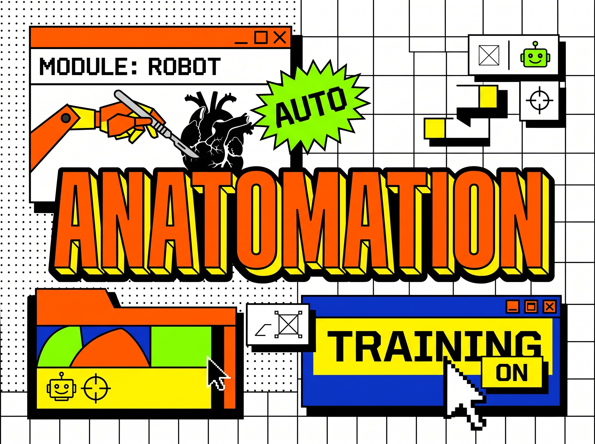
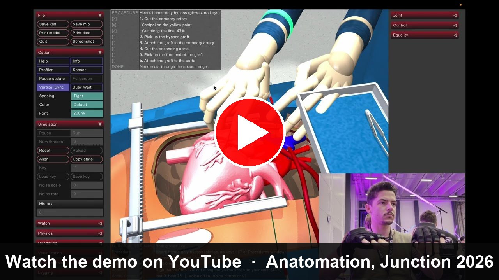
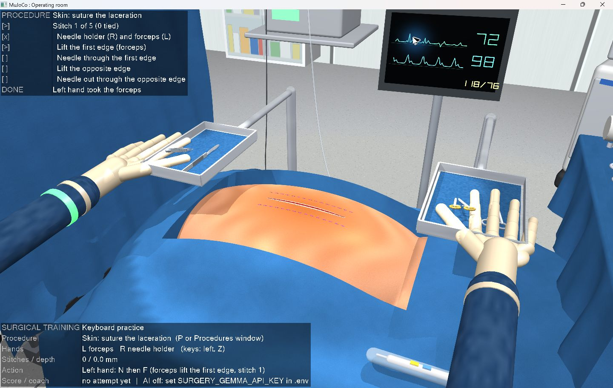
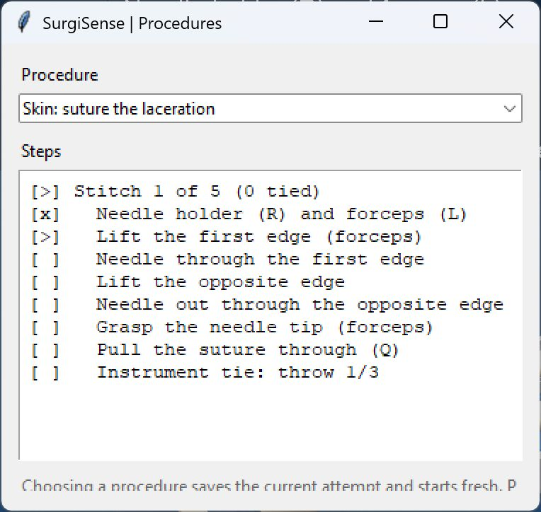
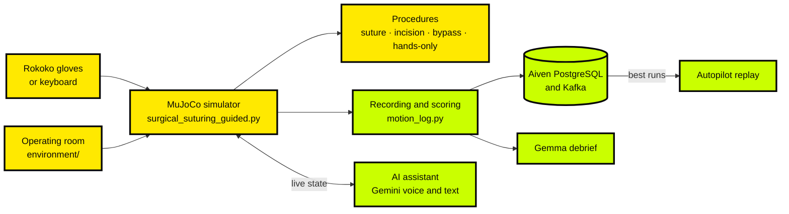
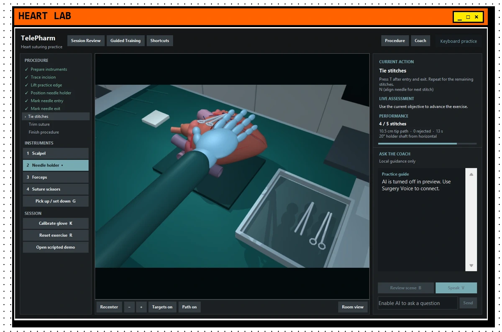
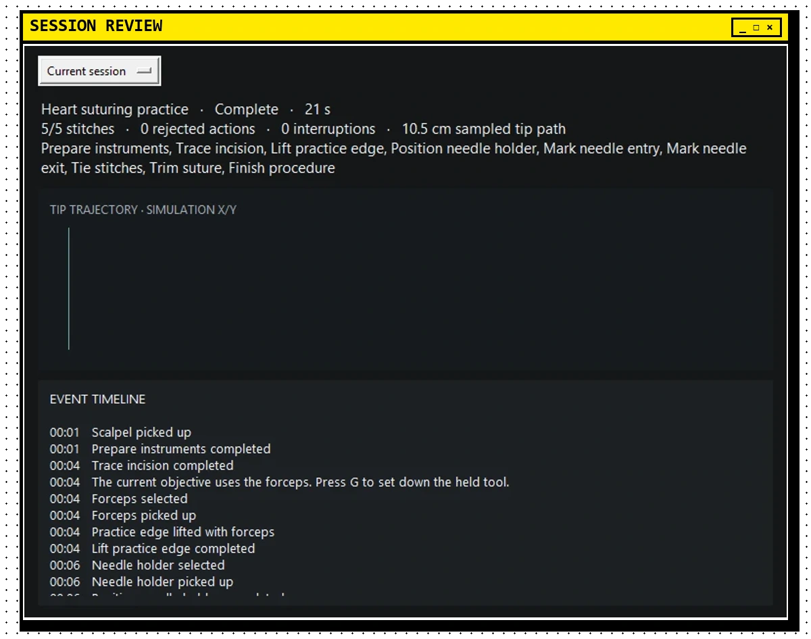
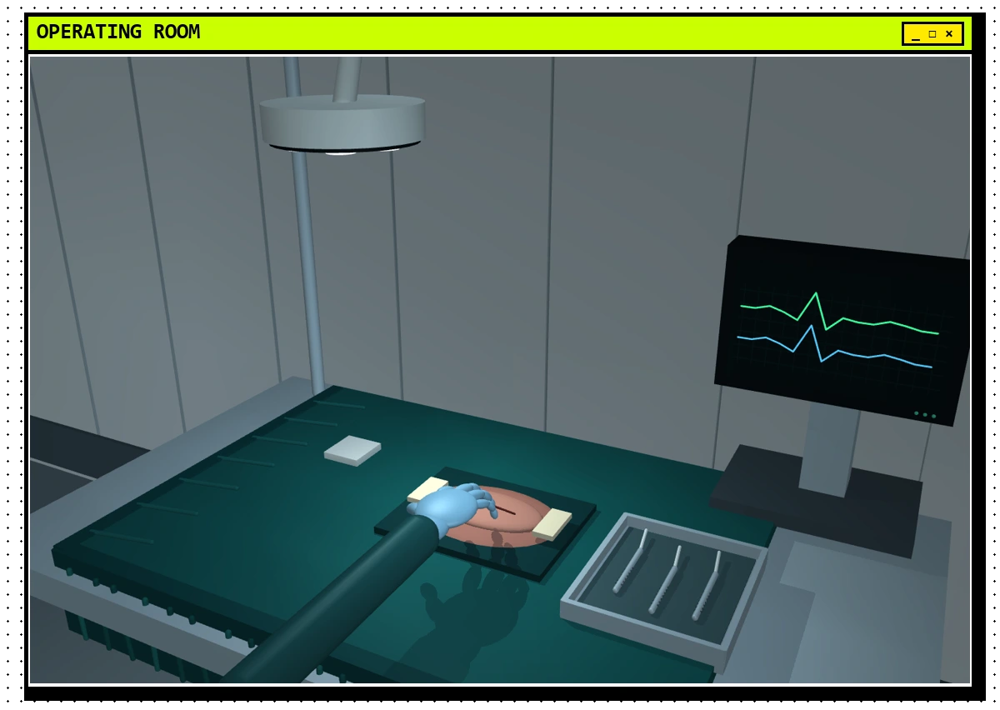
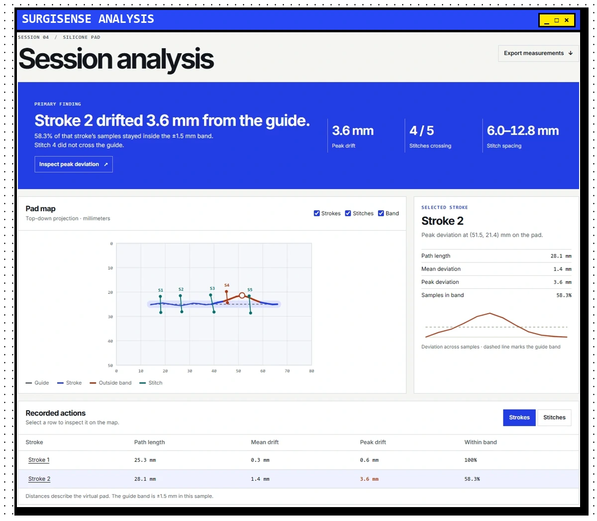
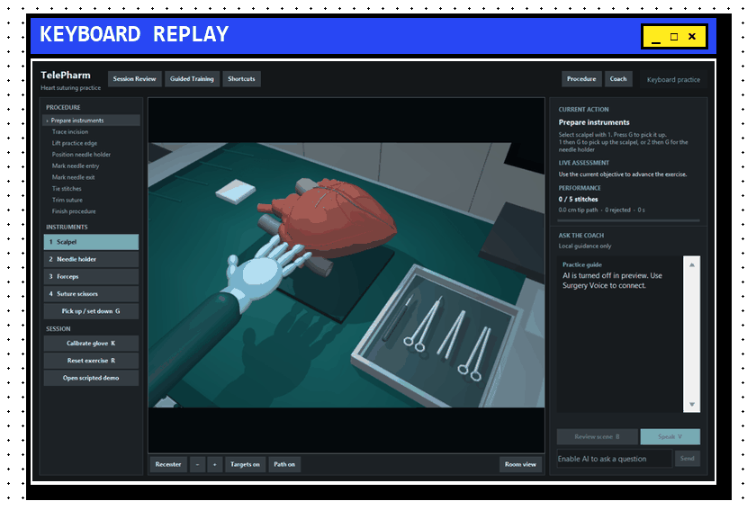

<div align="center">



# Anatomation

**Practise surgery with your own hands: a glove-tracked surgical simulator with an AI coach.**

Cut, stitch and perform a coronary artery bypass in a virtual operating room. Rokoko gloves move the instruments, every attempt is scored, and an AI assistant tells you what to do next.

## ▶ Watch the demo

<a href="https://www.youtube.com/watch?v=FWhLL2QjWyk" title="Watch the Anatomation demo on YouTube">
  
</a>

<sub>Click the picture to watch on YouTube · <a href="https://www.youtube.com/watch?v=FWhLL2QjWyk">youtube.com/watch?v=FWhLL2QjWyk</a> · Junction 2026</sub>

<br><br>

**[Why](#why-anatomation)** · **[What you can practise](#what-you-can-practise)** · **[Quick start](#quick-start)** · **[Hands-only modes](#hands-only-modes-gloves-no-keys)** · **[AI coach and scoring](#scoring-replay-and-ai-coach)** · **[How it works](#how-it-works)**


</div>

---

## Why Anatomation

| The problem | What Anatomation does |
| --- | --- |
| **Surgeons can't practise enough.** Cadavers, animal models and operating-room time are expensive and scarce. | Unlimited practice of skin suturing, incisions and a full coronary bypass, at no extra cost per attempt. |
| **Simulators don't feel like real hands.** A mouse, a keyboard or costly haptic hardware trains the wrong motion. | Motion-capture gloves turn your real wrist and finger movements into the instrument's movements. |
| **Expert feedback is scarce and subjective.** A senior surgeon has to watch every attempt. | Every attempt is recorded and scored objectively: time, instrument travel, needle accuracy and refused actions. |
| **Beginners get stuck.** It's easy to get lost in a complex procedure. | Step-by-step checklist, glowing yellow targets with snap points, and an AI assistant that answers "what do I do now?" in about a second. |
| **Some procedures can't be rehearsed at all.** | A guided coronary artery bypass graft on a real anatomical heart model, in a full cardiac operating room. |

## What you can practise

Pick a procedure from the **Procedures** window, which opens beside the simulator, or press <kbd>P</kbd> to move to the next one.

| Procedure | `--procedure` | What you do |
| --- | --- | --- |
| Skin: incision | `skin-incision` | Steady the skin with the left hand and cut along the marked line |
| Skin: suture the laceration | `skin-suture` | Five two-handed stitches with forceps and needle holder, each with an instrument tie (default) |
| Skin: free stitching | `skin-stitch` | Stitch anywhere along the cut, as many stitches as you like, with each step prompted |
| **Skin: hands-only suturing** | `skin-gloves` | Six highlighted stitches done with glove movements alone, **no keys** |
| Heart: incision | `heart-incision` | Incision on the left ventricle |
| Heart: suture the laceration | `heart-suture` | Repair a 3 cm laceration on the left ventricle |
| Heart: coronary artery bypass | `heart-bypass` | Cut the coronary artery → sew on the graft → cut the aorta → sew on the other end |
| Heart: free stitching | `heart-stitch` | Free stitching on the heart |
| **Heart: hands-only bypass** | `heart-gloves-bypass` | The full bypass with snap points, right hand only, **no keys** (the one in the video) |
| Skin / Heart: free practice | `skin-free`, `heart-free` | No prompts and no fixed order |

Everything happens in a full cardiac operating room: a draped patient, an opened chest with a retractor, a heart-lung machine, an anaesthesia machine, surgical lights and live monitors. The heart is the NIH 3D anatomical model.

### Take a look

[](docs/readme/current-heart-suture.jpg)

| The operating room | Skin suturing |
| :---: | :---: |
| [](docs/readme/current-operating-room.jpg) | [](docs/readme/current-skin-suture.jpg) |
| The table, the equipment and the animated displays. | A laceration on the curved chest, with the instruments ready for the first stitch. |

The **Anatomation | Procedures** window lists the exercises and ticks off each step of the current one:

[](docs/readme/current-procedures.jpg)

## Quick start

Python 3.11. Without gloves, `--preview` drives both hands from the keyboard.

**macOS** (MuJoCo's viewer needs `mjpython`):

```bash
python3 -m venv .venv && source .venv/bin/activate
pip install -r requirements.txt
mjpython surgical_suturing_guided.py --preview

# Start in a specific procedure:
mjpython surgical_suturing_guided.py --preview --procedure heart-bypass
```

**Windows** (PowerShell at the repository root):

```powershell
py -3.11 -m venv .venv
.\.venv\Scripts\python.exe -m pip install -r requirements.txt
.\.venv\Scripts\python.exe surgical_suturing_guided.py --preview
```

The **MuJoCo: Operating room** and **Anatomation | Procedures** windows open with **Skin: suture the laceration** selected.

### With Rokoko gloves

```bash
rokoko-sdk --auto-stream-usb               # terminal 1: glove driver
rkk-hand-solver --no-driver --emit-openxr  # terminal 2: hand solver
mjpython surgical_suturing_guided.py       # terminal 3: the simulator
```

The simulator reads both gloves straight from the solver (port 12277). If one glove isn't streaming, a keyboard-driven hand takes its place. To calibrate, rest your hands palm-down with the fingers toward the screen, and press <kbd>H</kbd> to recalibrate at any time.

<details>
<summary><strong>Keyboard controls</strong></summary>

| Action | Keys / mouse |
| --- | --- |
| Choose an instrument | <kbd>1</kbd> scalpel · <kbd>2</kbd> needle holder · <kbd>3</kbd> forceps · <kbd>4</kbd> scissors, then <kbd>G</kbd> to pick it up or set it down |
| Move the hand | Arrows and <kbd>Q</kbd>/<kbd>E</kbd>. <kbd>Z</kbd> swaps hands, <kbd>Y</kbd> moves both together, and double-clicking a hand selects it |
| Suturing | <kbd>N</kbd> aligns the tool · <kbd>F</kbd> grips or passes the needle · <kbd>T</kbd> throws a knot · <kbd>X</kbd> trims |
| Procedure | Procedures window or <kbd>P</kbd>. <kbd>R</kbd> scores the attempt and starts over |
| Camera | Scroll to zoom, left-drag to orbit, right-drag to pan, <kbd>0</kbd> to reset |
| AI coach | <kbd>I</kbd> assistant window · <kbd>V</kbd> voice on/off · <kbd>B</kbd> Gemma review |
| Help | <kbd>K</kbd> shows the key guide · <kbd>M</kbd> mutes the OR sounds |

The status bar always names the hand and the key for the next step. The full step-by-step technique is in **[SIMULATOR.md](SIMULATOR.md)**.

</details>

## Hands-only modes (gloves, no keys)

These modes are the telemetry showcase. The gloves report how your wrist turns and your fingers bend, so every step is done **by moving your wrist**: no keys, no arm movement.

1. The next target **glows yellow**.
2. The tool glides to just above it while the prompt says *"Relax your wrist: moving into place"*.
3. **Bend your wrist down.** A magnet draws the tool over the target, and it snaps in.
4. **Turn your wrist** to cut or to push the needle through, then **bend it up** to pull the thread.

In the **hands-only bypass**, the graft snaps into your hand and then onto the opening, so the whole operation runs as cut → pick up → attach → cut → pick up → attach. When it's finished, the graft fills with blood and pulses. Testing shows both modes can be finished within about 8° of side-to-side and 12° of up-and-down wrist movement.

## Scoring, replay and AI coach

- **Recording**: every attempt is recorded at 60 fps: both gloves' joints, every key and every instrument action.
- **Scoring**: each cut and each stitch is scored out of 100 on time, instrument travel, needle accuracy and refused actions.
- **Autopilot**: replays the best attempt at each site exactly, as a reference to learn from. It also exports a tool trajectory for a two-arm robot to `training-data/robot/`.
- **Where attempts go**: summaries go to `training-data/attempts/` and full recordings to `training-data/runs/`. An attempt is saved when you finish, press <kbd>R</kbd>, switch exercises or close the viewer.
- **AI assistant (Gemini)**: ask by voice or by typing, e.g. *"what do I do now?"*. It answers from the live state of the simulator: the current step, the hand to use and your last score compared with the best. In hands-only modes it gives wrist movements, never keys.
- **Debrief (Gemma)**: after each complete attempt, Gemma writes a short review from a rendered frame and the task scores. It runs on Modal with open weights, or on Google AI Studio.
- **Aiven**: attempts are saved locally first and then synced to **Aiven PostgreSQL**, which provides the best runs and benchmarks for everyone. Live telemetry streams to **Aiven Kafka**, and an instructor can follow it with `python telemetry_monitor.py`.

To set it up, run `pip install -r requirements-ai.txt` and copy [`.env.example`](.env.example) to `.env`. Then set `SURGERY_GEMMA_API_KEY` for Gemini and hosted Gemma, `GEMMA_MODAL_URL` and `GEMMA_MODAL_TOKEN` for Gemma on Modal, and the Aiven settings if you have them. Recording, scoring and the autopilot all work offline without them. Keep keys out of commits.

## How it works



| Files | Role |
| --- | --- |
| [`surgical_suturing_guided.py`](surgical_suturing_guided.py) | Entry point: glove tracking, instruments, two-handed cutting and suturing |
| [`or_scene.py`](or_scene.py), [`environment/`](environment/) | The scene: heart model, skin and heart surfaces, and the cardiac operating room |
| [`procedures.py`](procedures.py), [`bypass.py`](bypass.py) | The procedure list, incisions and the guided bypass |
| [`glove_suture.py`](glove_suture.py), [`glove_bypass.py`](glove_bypass.py) | Hands-only suturing and bypass (snap points, wrist-only movement) |
| [`motion_log.py`](motion_log.py) | Recording, scoring, autopilot and robot trajectory export |
| [`coach.py`](coach.py), [`gemini_voice.py`](gemini_voice.py), [`gemma_review.py`](gemma_review.py), [`assistant_window.py`](assistant_window.py) | The AI assistant and debriefs |
| [`aiven_store.py`](aiven_store.py), [`telemetry_monitor.py`](telemetry_monitor.py) | Aiven PostgreSQL sync and live Kafka telemetry |
| [`modal_gemma.py`](modal_gemma.py) | Gemma served on a Modal GPU |
| [`assets/heart-nih3d/`](assets/heart-nih3d/) | NIH 3D heart model |

The full guide covering controls, technique, sites and data is in **[SIMULATOR.md](SIMULATOR.md)**.

<details>
<summary><strong>Earlier prototype: TelePharm workstation</strong></summary>

Before the operating-room simulator, the team built **TelePharm**, a Windows workstation with a procedure checklist, session review and the SurgiSense browser workbench. Its code is not in this repository; these are screenshots from it.

| Heart workstation | Session review |
| :---: | :---: |
|  |  |
| **Operating room** | **SurgiSense analysis** |
|  |  |



</details>

## Credits

Built at **Junction 2026**. The cardiac operating room environment is by saimn80. The voice assistant and the TelePharm prototype are by hadi-ce04. The demo video is by Simon Steiner. The heart model is from the NIH 3D Print Exchange.

> The tissue, cuts and stitches are geometric simulations for training motion and procedure flow. The scores describe the virtual exercise and are not a validated clinical assessment.

<div align="right"><a href="#anatomation">Back to top ↑</a></div>
